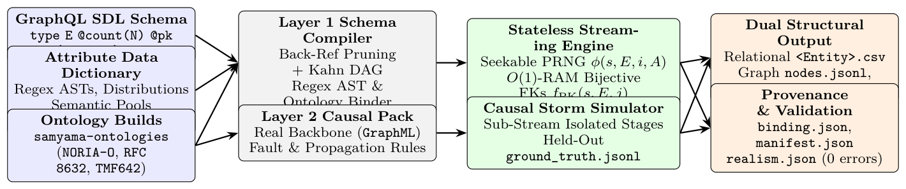

# Samyama-SDG: A Declarative GraphQL @count and Regex/Ontology Synthetic Data Compiler with $O(1)$-Memory Referential Integrity and Causal Ground Truth

- arXiv: https://arxiv.org/abs/2611.11295  (v1, submitted 2026-11-08, updated 2026-11-08)
- Authors: Madhulatha Mandarapu, Sandeep Kunkunuru
- Categories: cs.DB
- Collected: 2026-11-11 (KST)

## Abstract

Synthetic data generators face a divide between declarative relational mockets and domain causal simulators. Declarative generators specify entities, regexes, and foreign keys via schemas, but buffer parent primary-key pools in RAM ($O(N)$ memory) and lack ontology bindings or causal ground truth. Conversely, domain simulators emit realistic streams and ground-truth labels, but require thousands of lines of procedural code per domain. We present Samyama-SDG (sdg-rs), a Rust synthetic data compiler unifying declarative schema compilation with ontology-bound causal simulation. At Layer 1, Samyama-SDG compiles Cardinality-Extended GraphQL schemas (@count, @pk, @ontology, @regex, @dist, @fk, @after) and an Attribute Data Dictionary into a topologically sorted DAG. Combining stateless counter-based seekable PRNGs (SplitMix64 over $(\text{seed}, \text{entity}, \text{row}, \text{field})$) with index-bijective primary keys $f_{\text{PK}}(s, E, i)$ lets child tables resolve uniform or Zipfian foreign keys and multi-hop @after constraints in $O(1)$ memory without buffering parent tables. At Layer 2, causal processes layer fault propagation and machine-scorable ground truth (ground_truth.jsonl) over the same seekable PRNG and samyama-ontologies binder. Across three schemas, Samyama-SDG generates $1{,}000{,}000$ records in $128.79\text{ ms}$--$172.43\text{ ms}$ ($5.80\text{M}$--$7.76\text{M}$ rows/s) and $5{,}000{,}000$ records in $676.12\text{ ms}$--$808.56\text{ ms}$ at flat $31.4\text{ MiB}$--$35.1\text{ MiB}$ memory, with $0$ conformance errors across $1{,}150{,}000$ foreign keys and $900{,}000$ temporal constraints.

## Figure 1

Fig. 1. Architecture of the Samyama-SDG compiler (sdg-rs). Layer 1 compiles Cardinality-Extended GraphQL SDL schemas, an Attribute Data Dictionary, and samyama-ontologies builds into a lock-free Rayon streaming plan with O(1)-memory index-bijective foreign keys. Layer 2 layers causal fault propagation and ground-truth logging over the same seekable PRNG and vocabulary binder.
