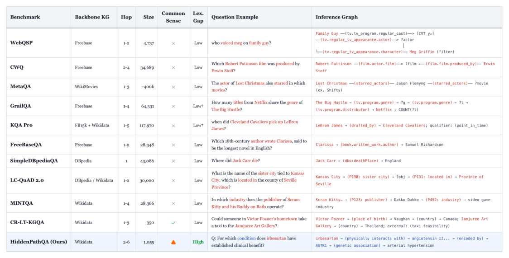

# HiddenPathQA: A Benchmark for Knowledge Graph Question Answering When Questions Hide Their Paths

- arXiv: https://arxiv.org/abs/2611.11802  (v1, submitted 2026-11-09, updated 2026-11-09)
- Authors: Sumin Jo, Edward Choi
- Categories: cs.CL, cs.AI
- Collected: 2026-11-11 (KST)

## Abstract

Knowledge graph question answering (KGQA) systems are typically evaluated on questions whose surface tokens lexically expose the gold KG path. Users, however, may ask questions without knowing the underlying schema: "Which condition could Andrew have due to family history?" compresses a 4-hop chain "Andrew --[father]--> parent --[father]--> grandparent --[medical condition]--> disease --[subclass of]--> hereditary disorder" into a single phrase (family history) that names none of those relations. We identify this collapse of path-question alignment as a blind spot in existing KGQA evaluation. Three major LLM-KG paradigms, hop-by-hop exploration, plan-then-retrieve, and similarity-based retrieval, implicitly rely on such lexical cues, an assumption rarely tested in practice. We make three contributions. (i) We introduce HiddenPathQA, a manually verified benchmark of 1,055 questions spanning 2-6 hops and multiple domains, constructed so that question wording does not reveal the gold path's relations. (ii) We propose Holistic Path Selection, which compares questions against candidate relation chains in the local subgraph as complete units, replacing irreversible per-hop relation scoring with globally informed chain-level reasoning. We develop two implementations, TieredHolistic and FlatHolistic. (iii) We conduct a pseudoword stress test that replaces entity names with meaningless placeholders to distinguish KG-grounded reasoning from entity-level memorization. Holistic Path Selection outperforms six strong KGQA baselines (ToG, PoG, FiDeLiS, R2-KG, KAPING, and KARPA) by 8.8-17.9 accuracy points across two LLM backbones and both original and pseudoword settings. Its advantage under pseudoword replacement shows that the gains cannot be explained by entity-level memorization alone.

## Figure 1

Figure 1: Overview of KGQA benchmarks alongside HIDDENPATHQA. Red = entities/relations appearing (almost) verbatim in both the question and the inference graph (low lexical gap). Blue = entities/relations appearing in only one of the two (high lexical gap). Low†: questions derived from a logical form, where surface overlap is reduced but path–question alignment is preserved at the logical-form level. ▲: HIDDENPATHQA does not test commonsense, but uses compressed expressions (e.g., aunt-in-law) that the LLM must interpret to recover the correct relation chain.
