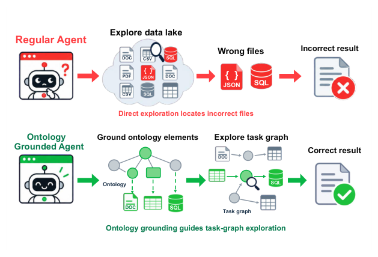

# OGDA: Ontology-Grounded Data Agents for Reliable Analysis over Heterogeneous Data Lakes

- arXiv: https://arxiv.org/abs/2611.12114  (v1, submitted 2026-11-09, updated 2026-11-09)
- Authors: Boyi Zhang, Hong Ting Tsang, Yisen Gao, Qiao Xiao, LI Yufei, Haoyu Huang, Zhongwei Xie, Jiaxin Bai, Yangqiu Song
- Categories: cs.AI, cs.CL
- Collected: 2026-11-11 (KST)

## Abstract

Full-pipeline data analysis over real-world data lakes requires LLM agents to locate and integrate information across large collections of tables with different schemas. Existing data agents follow task-specific exploration, which exhausts the context window in massive lakes. As the context fills, the agent's reasoning degrades, leading it to locate and process incorrect data files. These errors propagate into the final answer. To overcome these limitations, we introduce Ontology-Grounded Data Agent (OGDA), which utilizes a compact ontology to reduce exploration overhead and constrain data processing. OGDA constructs the ontology through agentic hypothesis testing. At each step, a proposer agent induces schemas, concepts, and relations from raw sources, and a verifier checks each proposal against the underlying data. During task execution, the ontology serves as a representation of the data lake for the agent to explore. Every data-processing action is constrained by a task graph, which the agent can extend only after observing the semantic meaning of the data. Across KramaBench and DiscoveryBench with three LLM backbones, OGDA outperforms the strongest baselines by up to 10.82 points. These results suggest that explicitly modeling the data lake is a key step toward reliable end-to-end data agents.

## Figure 1

Figure 1: Direct exploration can select incorrect files and propagate source-selection errors into the result. OGDA grounds relevant ontology elements in an ex- plicit task graph that guides exploration of the corre- sponding sources.
