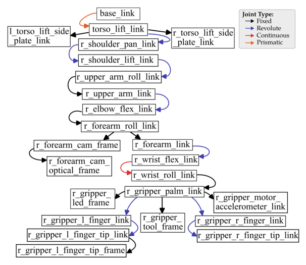

# Taxonomy-Agnostic Neurosymbolic Grounding of Robot Kinematics

- arXiv: https://arxiv.org/abs/2611.13850  (v1, submitted 2026-11-10, updated 2026-11-10)
- Authors: Bastien Dussard, Aur{é}lie Clodic, Guillaume Sarthou
- Categories: cs.AI, cs.RO
- Collected: 2026-11-12 (KST)

## Abstract

While symbolic reasoning for task allocation requires grounding a robot's physical capabilities, standard Unified Robot Description Format (URDF) files provide only low-level kinematics without the formal semantic context needed for reasoning. We present URDF2Ontology, an automated, taxonomy-agnostic neurosymbolic framework that transforms raw URDF files into populated, grounded OWL ontologies. It leverages a Large Language Model (LLM) for targeted semantic reasoning, coupled with an iterative sequential graph-purging mechanism to prevent context window saturation. To process complex kinematic structures, it employs a morphology-aware dual-track architecture featuring a bottom-up Tree Track for branching assemblies and a top-down Chain Track for serial limbs. Guided by neurosymbolic guardrails, the framework extracts functional sub-graphs and asserts populated ontologies aligned with arbitrary user-provided taxonomies. Empirical evaluation across a diverse fleet of heterogeneous robots demonstrates strong schema alignment, valid structural extraction, and a significant reduction in manual domain authoring overhead.

## Figure 1

Figure 1: Kinematic link tree of the PR2 right arm ex- tracted from its URDF topology. Directed edges represent parent-to-child joint transformations, color-coded by joint type (joint identifiers omitted for visual clarity).
