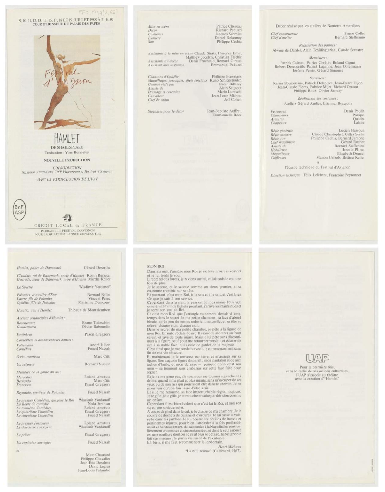

# From Show Programs to Linked Data

- arXiv: https://arxiv.org/abs/2611.14037  (v1, submitted 2026-11-10, updated 2026-11-10)
- Authors: Clarisse Bardiot, Bernard Jacquemin, Jacob Hart, George Bruseker, Antonios Lagarias, Pierre-Carl Langlais, Brandon Farnsworth, Jeanne Fras
- Categories: cs.IR
- Collected: 2026-11-12 (KST)

## Abstract

Many heritage institutions hold extensive collections of show programs. Too numerous to be cataloged individually, they remain difficult to access and are still largely undigitized. This paper presents a workflow for transforming such documents into structured, interoperable data by combining vision-language models (VLMs), a custom extension of the Linked Art ontology for the performing arts, and different approaches for automatic semantic data annotation. Using the Festival d'Avignon programs (1947--present), preserved at the Biblioth{è}que nationale de France, as a case study, we demonstrate how VLMs achieve more than 98% text transcription accuracy from heterogeneous heritage document images and how constraining large language model generation through a knowledge graph significantly reduces hallucinations in semantic annotation. We argue that this workflow opens new possibilities for large-scale, interoperable performing arts historiography, including the creation of catalogues raisonn{é}s for performing artists, a form of scholarship common in visual arts but absent in performing arts studies.

## Figure 1

Figure 1: The show program (6 pages) of Patrice Chéreau, Hamlet, Festival d’Avignon, 1988. Bibliothèque nationale de France. Recueil. Festival d’Avignon, 1988. Documents de programmation. PFA-1988 (2,65).
