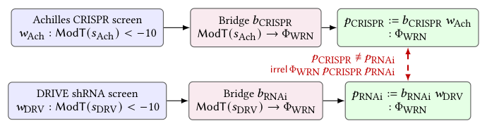

# Typed Knowledge over Constructive Institutions: A Proof-Relevant Type Theory for Verified Science

- arXiv: https://arxiv.org/abs/2611.15108  (v1, submitted 2026-11-11, updated 2026-11-11)
- Authors: Hans-Martin Will
- Categories: cs.LO, cs.AI, cs.CL
- Collected: 2026-11-16 (KST)

## Abstract

Mathematical proof assistants such as Coq, Agda, and Lean 4 build proof irrelevance into definitional conversion ($p \equiv q$ for $p, q : P$ with $P : Prop$), erasing which derivation established a theorem. While natural for mathematics over fixed axioms, judgmental proof irrelevance is incompatible with verified scientific stores, which must inspect and compare independent derivations of the same claim to assess consilience and compute counterfactual retractions when an assay, reagent, or model is invalidated. Moreover, combining definitional proof irrelevance with subsingleton elimination breaks strong normalization and renders algorithmic conversion non-transitive. We present the type-theoretic and institutional foundations of Eigenius, a verified knowledge substrate for science. First, we formulate a dependent kernel with cumulative universes ($Prop, Set, Type_k$), impredicative $Prop$, inductive families with index-forced subsingleton elimination, and intensional identity types, where definitional equality $\equiv$ is untyped joinability under an orthogonal CRS and proof irrelevance is a witnessed propositional axiom ($irrel : ΠP{:}Prop.\,Πp,q{:}P.\,Id\,P\,p\,q$). Second, we unify universe cumulativity, codomain-covariant $Π$-subtyping, and ontology class inclusions in a coercion-free subsumption judgment whose bidirectional fragments ($\mathcal{K}_0, \mathcal{K}_1$) satisfy subject reduction and are sound and complete for declarative typing. Third, we organize external verifiers into a three-level institutional hierarchy with explicit axiom policies (Adopt, Discharge, Relativize), internalize a justification logic with Why-provenance semiring support $supp(j,P)$, and embed Cooper's Type Theory with Records (TTR) to type open-world knowledge graphs. Finally, we prove consistency in Grothendieck universes and mechanize the metatheory in Lean 4 with zero sorry axioms.

## Figure 1

Figure 1: Two independent experimental derivations 𝑝CRISPR, 𝑝RNAi : ΦWRN in the WRN synthetic lethality study [12, 45]. Eigenius keeps 𝑝CRISPR̸ ≡𝑝RNAi distinct under conversion while witnessing their propositional equality via irrel.
