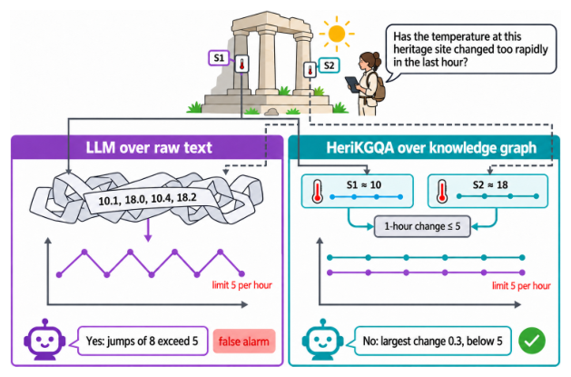

# HeriKGQA: Grounded Knowledge-Graph Question Answering over Cultural Heritage Sensor Data

- arXiv: https://arxiv.org/abs/2611.15904  (v1, submitted 2026-11-11, updated 2026-11-11)
- Authors: Lingxiao Kong, Vasileios Arampatzakis, Vasileios Sevetlidis, George Pavlidis, Zeyd Boukhers
- Categories: cs.CL, cs.AI, cs.DB, cs.IR
- Collected: 2026-11-16 (KST)

## Abstract

Cultural heritage sites are increasingly monitored by sensor networks, but querying their data requires database expertise. Large Language Models (LLMs) offer a natural-language interface, yet over raw sensor records they lose track of which sensor, site, and time each value belongs to, and silently miscompute. We present HeriKGQA, a knowledge-graph question-answering method that confines the LLM to interpreting questions and phrasing answers, leaving computation to SPARQL and deterministic code. Questions are parsed into intents constrained by a heritage ontology aligning W3C SOSA/SSN with CIDOC-CRM, compiled into SPARQL, and answered from query results and temporal, spatial, and anomaly facts derived by a grounding layer, with error correction guarding each LLM step. On 500 questions over real data from five heritage sites, HeriKGQA reaches 99.0% accuracy, 18.2 points above the strongest of three baselines using the same LLM and receiving the same anomaly rules and answer conventions, with comparable answer quality while running almost four times faster. Without grounding, accuracy drops by 12.2 points and on anomaly questions from 99% to 66%. We report lessons from development and live deployment.

## Figure 1

Figure 1: Example challenge of QA over heritage data. Over raw text, the LLM mixes two sensors’ read- ings and raises a false alarm (left); HeriKGQA evaluates sensors separately over the knowledge graph (right).
