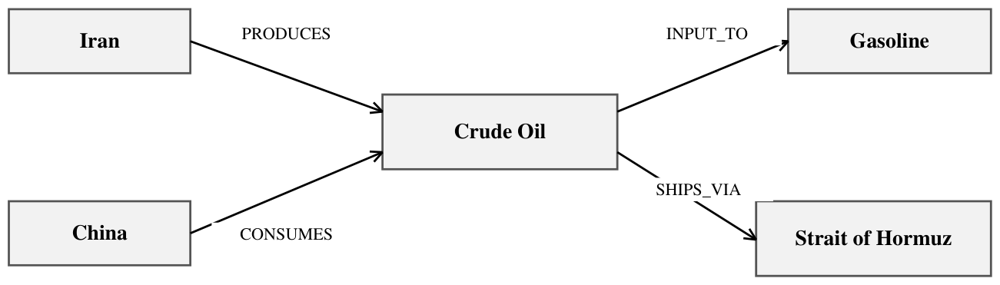

# Causals: An Open Knowledge Graph for Research on Causal Reasoning

- arXiv: https://arxiv.org/abs/2611.16267  (v1, submitted 2026-11-12, updated 2026-11-12)
- Authors: Miaozhe Lin, Qiongzheng Lin, Zhongwei Liang, Zijun Liu
- Categories: cs.AI
- Collected: 2026-11-16 (KST)

## Abstract

Applying causal knowledge to a new event requires connecting the event to relevant entities and the relationships through which its consequences may unfold. We present Causals, an open knowledge graph for research on this form of reasoning. Its initial release, constructed from news reports, contains 369,184 nodes and 1,272,418 edges linking reported events, organizations, commodities, financial instruments, and other entities. Structural relationships, observations, and attributed causal claims retain distinct semantics and links to source records. We describe the construction and representation of the resource and characterize its connectivity and multi-hop retrieval properties. Causals provides shared relational knowledge for studying how language models retrieve relevant context and apply mechanisms to particular events. The dataset is available under CC BY 4.0 at https://causals.org/, and we invite contributions to its ontology, records, and evidence.

## Figure 1

Figure 1. A neighborhood in Causals v0.1.0-2026-10-09. Labels and arrow directions reproduce the stored relationships.
