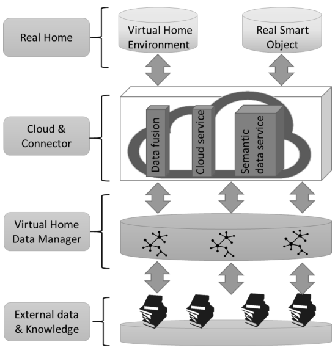

# Use-case-driven ontology modeling with the NeOn methodology for ambient assisted living

- arXiv: https://arxiv.org/abs/2611.17466  (v1, submitted 2026-11-12, updated 2026-11-12)
- Authors: Daniele Spoladore, Marco Sacco, Alberto Trombetta, Edoardo Battisti
- Categories: cs.DB, cs.AI
- Collected: 2026-11-17 (KST)

## Abstract

Research on smart homes and ambient assisted living (AAL) has grown steadily over the last decade, driven largely by the ageing of the population. A smart home has to coordinate heterogeneous smart objects in order to offer services tailored to its dwellers, and this requires a shared formal description of both the dwellers and the devices. We present the ontology developed as the semantic data layer of the Virtual Home Framework in the Italian Design For All project. Its requirements are derived from two use cases: a frail elderly woman who exercises at home on a cycle-ergometer, and a designer who configures a kitchen for users with different impairments. The requirements are collected in an Ontology Requirements Specification Document and the ontology is built with the NeOn methodology, reusing and reengineering existing ontologies where possible. The resulting modular ontology describes users through the International Classification of Functioning, Disability and Health (ICF) and through their cardiorespiratory fitness; it also describes smart objects, their programs, the measurements they produce, and the comfort dimensions of the home. SWRL rules classify fitness levels, suggest exercise loads, assess indoor comfort, and identify the smart objects suited to a given impairment.

## Figure 1

Figure 1: The Virtual Home Framework.
