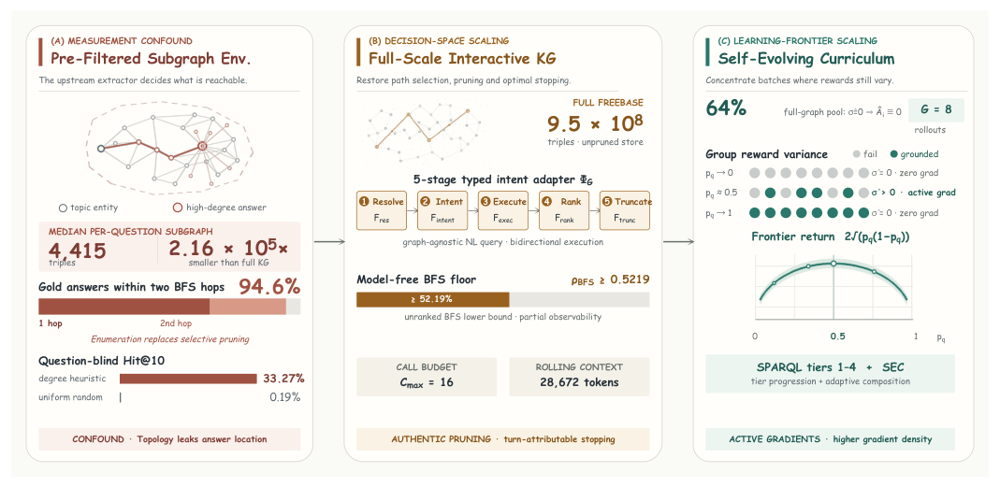

# Interactive Structured Environment Scaling for Large Language Model Agentic Reasoning

- arXiv: https://arxiv.org/abs/2611.19871  (v1, submitted 2026-11-15, updated 2026-11-15)
- Authors: Peng Yu, Luoyi Fu, Xinbing Wang, Ying Wen
- Categories: cs.AI, cs.LG
- Collected: 2026-11-17 (KST)

## Abstract

Reinforcement learning via environmental interaction is a cornerstone post-training paradigm for evolving large language models into autonomous agents capable of multi-turn tool use and exploration. Because the environment defines what the policy observes and how actions are verified, its structure directly bounds the capabilities an agent can acquire. Yet existing structured and retrieval environments rely on upstream pre-filtering---extracting a compact subgraph around the gold answer or retrieving fixed passages before the policy acts. We show that such pre-filtering introduces a fundamental measurement confound: because per-question subgraphs enclose ground-truth paths, they compress the candidate space by orders of magnitude and leak answer locations via local topology, allowing a question-blind degree heuristic to surface gold answers far above chance. To restore path selection, candidate pruning, and optimal stopping as genuine policy decisions, we propose RISE (Interactive Structured Environment), which transitions structured reinforcement learning from static subgraphs to full-scale interactive databases along two coupled axes. First, Decision-Space Scaling exposes the unpruned knowledge graph via a five-stage graph-agnostic typed intent adapter under a bounded call budget and a multiplicative grounding reward gate. Second, Learning-Frontier Scaling overcomes within-group variance collapse under group-normalized objectives by uniting model-independent structural tier progression with a self-evolving competence-frontier bandit. Across nineteen benchmarks and three model backbones, RISE substantially advances in-domain and unseen-schema knowledge-graph reasoning, transfers zero-shot to open-domain passage retrieval, and significantly enhances out-of-domain mathematical and logical deduction.

## Figure 1

Figure 1: Motivation and the two scaling axes of RISE. (A) Pre-filtered subgraph environments com- press the candidate space by 2.16 × 105× and leak answer locations through node degree (33.27% question-blind Hit@10 vs. 0.19% uniform random). (B) Decision-Space Scaling exposes the full 9.5 × 108-triple store through a five-stage graph-agnostic typed intent adapter ΦG under a bounded call budget (Cmax = 16) and rolling context (28,672 tokens). (C) Learning-Frontier Scaling over- comes the 64% zero-variance bottleneck of full-graph group-normalized RL (G = 8) by uniting SPARQL structural tiers 1–4 with the Self-Evolving Curriculum (SEC) bandit (pq ≈0.5; see Ap- pendix B).
