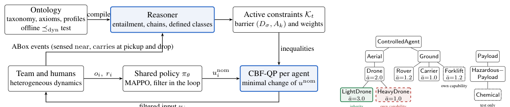

# Ontology-Compiled Control Barrier Functions for Heterogeneous Robot Teams

- arXiv: https://arxiv.org/abs/2611.20306  (v1, submitted 2026-11-15, updated 2026-11-15)
- Authors: Peng Wu, Seyede Fatemeh Ghoreishi, Nathan Bastian, Mohsen Imani, Tian Lan, Mahdi Imani
- Categories: cs.RO, cs.LG
- Collected: 2026-11-18 (KST)

## Abstract

Safety filters for heterogeneous robot teams fail because of missing constraints, overestimated braking capabilities and conflicts between individually satisfiable constraints. We present OntoCBF, which compiles a domain ontology with a class taxonomy, typed relations, safety axioms and a dynamics profile per robot class into a control barrier function filter with one quadratic program per agent. Description-logic entailment supplies the constraints of any team online, including those that follow from chains of relations and from classes defined by what a robot carries, so the existing safety axioms cover new robot classes, payload classes and combinations. We prove that a subclass may reuse the braking capability of its parent whenever it can produce every velocity of the parent, a property separate from subsumption. For box-bounded double integrators this property is also necessary, and every loss of safety then begins with a conflict. Once three robots interact, the safe set of pairwise barriers contains states from which a collision is unavoidable, and such states persist in larger teams under any fixed capability reduction. In a simulated warehouse where humans ignore the robots, a filter written for the design classes violates safety in 89-100 % of the episodes with unseen classes. In all scenarios, including one with 32 robots, OntoCBF violates safety in 20-70 % of the episodes, each time after a conflict, with a median deepest intrusion of 10-17 % of the keep-out distance. A multi-agent PPO policy trained with the filter in the loop lowers the rate of infeasible quadratic programs, nearly all of them conflicts, by 18-41 %.

## Figure 1

Figure 1: (a) OntoCBF. (b) Robot classes with per-axis acceleration limits ¯a (m/s2), and payload
