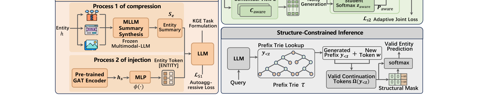

# NaviGATE: Noise-Aware Dual-View Generation for Multimodal Knowledge Graph Reasoning

- arXiv: https://arxiv.org/abs/2611.24552  (v1, submitted 2026-11-18, updated 2026-11-18)
- Authors: Jie Peng, Yongxue Shan, Yongfu Zha, Cui Miao, Xiaodong Wang
- Categories: cs.AI
- Collected: 2026-11-20 (KST)

## Abstract

Multimodal knowledge graph reasoning (MKGR) aims to infer missing facts by jointly exploiting relational structures, textual descriptions, and visual evidence. Existing embedding-based methods effectively capture graph topology, but their fixed multimodal representations are less effective for query-specific fine-grained semantic reasoning, while generation-based methods are vulnerable to noisy retrieval and may produce invalid entities. To address these challenges, we propose NaviGATE, a noise-aware generative framework for MKGR. NaviGATE first aligns graph-derived structural representations with textual semantics, then performs structure-aware internal knowledge activation by fine-tuning the multimodal language model with multimodal entity summaries and injected structural tokens. In the noise-aware dual-view instruction tuning stage, NaviGATE jointly optimizes retrieval-free and retrieval-aware views: reliable retrieved candidates are reinforced through contrastive logit sharpening, while misleading candidates are suppressed through parametric consistency distillation. In inference, structure-constrained decoding restricts generation to valid entities in the target knowledge graph. Experiments on standard benchmarks show that NaviGATE consistently outperforms strong unimodal, multimodal, and generation-based baselines, and remains robust under noisy retrieval scenarios.

## Figure 1

Figure 1: Overview of NaviGATE. The framework consists of three progressive training stages: structure-semantic collaborative alignment, structure-aware internal knowledge activation, and noise-aware dual-view instruction tuning. At inference time, structure-constrained decoding ensures valid entity generation.
