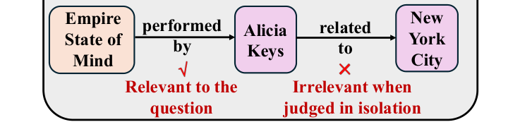

# LSP-RAG: Latent Scoring Perspectives for Knowledge Graph Retrieval-Augmented Generation

- arXiv: https://arxiv.org/abs/2611.25229  (v1, submitted 2026-11-18, updated 2026-11-18)
- Authors: Haochen Liu, Guanghui Min, Song Wang, Yada Zhu, Chen Chen, Jundong Li
- Categories: cs.IR
- Collected: 2026-11-20 (KST)

## Abstract

Large Language Models (LLMs) have demonstrated strong capabilities in open-domain question answering, but often struggle with factual accuracy and multi-hop reasoning due to the incompleteness of the training corpora. A promising solution is Knowledge Graph Retrieval-Augmented Generation (KG-RAG), which supplements LLMs with structured knowledge retrieved from external knowledge graphs (KGs). However, existing KG-RAG methods either rely on large-scale language models (e.g., ChatGPT) to guide the retrieval process, which leads to high computational costs, or suffer from limited retrieval quality when using lightweight language models, particularly under multi-hop scenarios. We propose LSP-RAG (Latent Scoring Perspectives for Retrieval-Augmented Generation over Knowledge Graphs), a novel KG-RAG framework that enhances hop-wise KG knowledge retrieval through multi-perspective prompted scoring. Each latent scoring perspective is guided by a combination of two types of soft prompts: a perspective-specific soft prompt induces a distinct prompt-conditioned scoring function over candidate triplets, while a contextual soft prompt evolves with each reasoning hop by encoding the query and previously explored KG triplets, enabling the model to preserve consistency and relevance across multi-hop retrieval. Rather than assuming manually defined semantic roles, these latent perspectives are adaptively aggregated to capture heterogeneous relevance signals during retrieval. This design allows LSP-RAG to perform accurate and robust retrieval using lightweight language models. LSP-RAG achieves superior performance across multiple KG-based Question Answering benchmarks compared to existing retrieval systems, including those that rely on much larger language models, demonstrating its effectiveness under limited computational budgets.

## Figure 1

Fig. 1: Illustration of two key challenges in KG-RAG. In Challenge 1, candidate triplets from the same entity may reflect heterogeneous matching signals, such as direct factual rele- vance, temporal association, or indirect relational connection, making a single scoring strategy less flexible for effective retrieval. In Challenge 2, a relation like related to may appear irrelevant when judged in isolation, but becomes crucial when combined with prior steps.
