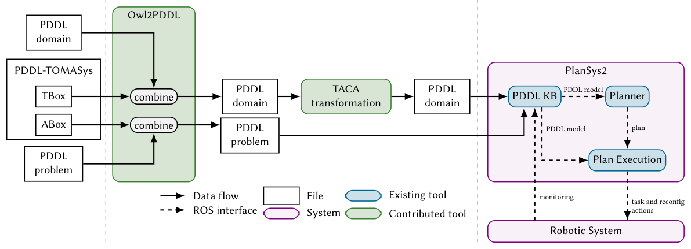

# Plan your Self-Adaptation! Ontology-Mediated Task and Architecture Co-adaptation Planning for Robots

- arXiv: https://arxiv.org/abs/2611.25254  (v1, submitted 2026-11-18, updated 2026-11-18)
- Authors: Gustavo Rezende Silva, Tobias John, Francisco Martín, EinarR Broch Johnsen
- Categories: cs.RO, cs.AI
- Collected: 2026-11-20 (KST)

## Abstract

Autonomous robots may need to adapt both their task plans and architectural configurations as operating conditions change. These decisions are interdependent: architectural configurations determine which actions a robot can perform, while task plans determine which capabilities are required. This paper presents PLANTA, an ontology-mediated approach to task and architecture co-adaptation that considers these dependencies during mission planning. PLANTA uses an ontology expressed in the Web Ontology Language to represent architectural alternatives and their associated functional and quality requirements, while the Planning Domain Definition Language defines task actions and mission goals. By automatically translating and integrating these models, PLANTA enables joint planning of task and reconfiguration actions. The approach uses satisficing planning and replans when changes during execution invalidate the current plan. PLANTA is evaluated in two robotic scenarios involving underwater inspection and ground navigation. The results support the feasibility of runtime co-adaptation and show lower planning time and memory consumption compared with optimal-policy generation in the evaluated navigation scenario, while producing plans of similar quality.

## Figure 1

Fig. 1. PLANTA framework, organized into design time, deployment time, and runtime, separated by dashed vertical lines. Some PlanSys2 nodes are omitted for clarity, and the Planner and Plan Execution components shown were extended as part of this work.
