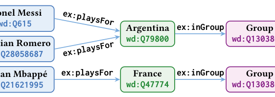

# GenSPARQL: A Generative Extension of SPARQL for Incomplete Knowledge Graphs

- arXiv: https://arxiv.org/abs/2611.26062  (v1, submitted 2026-11-19, updated 2026-11-19)
- Authors: Jingcheng Wu, Yi Wang, Hongkuan Zhou, Steffen Staab, Bo Xiong
- Categories: cs.DB, cs.AI
- Collected: 2026-11-23 (KST)

## Abstract

Knowledge graphs on the Web are incomplete, and SPARQL answers a query only from the stored triples. Large language models (LLMs) can predict missing facts, but an LLM returns names instead of IRIs and requires one call per binding of a query variable. We present GenSPARQL, a generative extension of SPARQL 1.1 with an operator GENOP that binds values generated by an LLM to query variables during query evaluation. A similarity join maps generated names to entities of the graph, and the query planner invokes the LLM only for the bindings selected by the other graph patterns and filters. In a web workbench, attendees query two graphs built from Wikidata and inspect generated values, mapped entities and LLM calls. In our evaluation with three open-weight LLMs, the embedding similarity maps 83% of the entities named by the LLMs and yields only one incorrect match.

## Figure 1

Figure 1: Excerpt of the 2026 World Cup graph.
