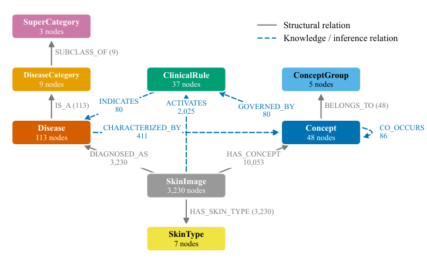

# DermKG: A Concept-Centric Knowledge Graph for Interpretable Skin Disease Diagnosis from Dermatological Morphology

- arXiv: https://arxiv.org/abs/2611.27283  (v1, submitted 2026-11-20, updated 2026-11-20)
- Authors: Cheng Huang, Yanmei Li, Mao Lin
- Categories: cs.AI
- Collected: 2026-11-24 (KST)

## Abstract

Dermatologists describe lesions with a standardized morphological lexicon, which makes concept-based models attractive for interpretable skin disease diagnosis. How much diagnostic information these concepts actually carry, however, is rarely quantified. We present DermKG, a concept-centric knowledge graph built on the expert-annotated SkinCon subset of Fitzpatrick17k (3,230 images, 48 concepts, 113 diseases). DermKG has 3,452 nodes of 8 types and 19,365 edges of 11 relation types, and encodes disease concept profiles, concept co-occurrence, a three-level diagnostic hierarchy, and 20 clinical morphology rules, all of which are supported by the training data (15 strong, 5 moderate). An information-ceiling analysis shows that the 3,230 lesions collapse onto only 813 distinct concept vectors, bounding concept-only top-1 accuracy at 38.9\% for diseases and 77.6\% for the nine categories. Within this bound, DermKG-Net, a graph neural network that scores lesions against disease prototypes and aggregates them along the hierarchy, raises category-level balanced accuracy from 0.257 to 0.411 over the strongest of 11 baselines (paired bootstrap difference $+0.150$, 95\% CI $[0.073, 0.231]$) and more than doubles minority-category recall. Ablations show that most of this gain comes from the hierarchical prototype objective, with a smaller contribution from graph structure. DermKG further yields rule-based reasoning chains and concept-level explanations for individual predictions.

## Figure 1

Fig. 1. DermKG schema: 8 node types (node counts) and 11 relation types (edge counts). Solid gray: structural relations read from annotations. Dashed blue: knowledge and inference relations derived from training statistics and clinical rules.
