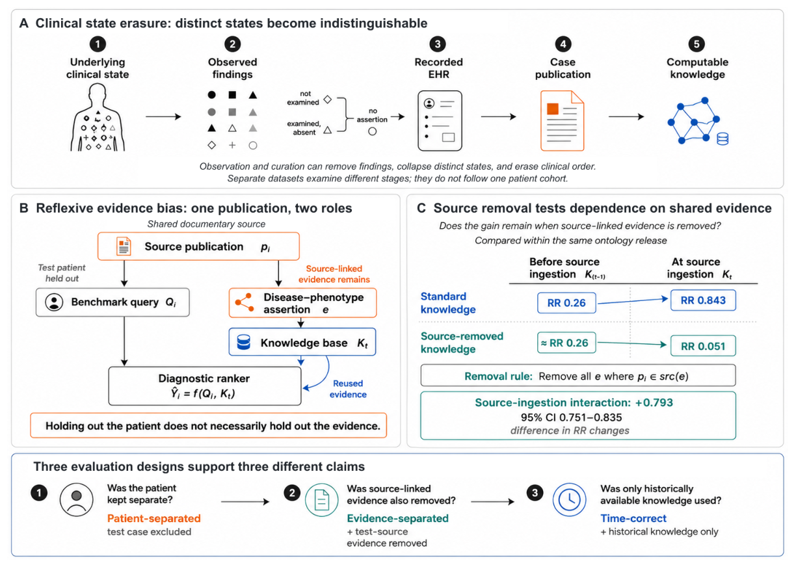

# Observed, Curated, Reused: Observation Bias in Clinical AI Evaluation

- arXiv: https://arxiv.org/abs/2611.27301  (v1, submitted 2026-11-20, updated 2026-11-20)
- Authors: Md Shamim Ahmed, Lukas Galke Poech, Richard Röttger
- Categories: cs.CL
- Collected: 2026-11-24 (KST)

## Abstract

Clinical AI evaluations are vulnerable to observation bias embedded in routine medical documentation, which captures only what clinicians notice, test, and record rather than a complete clinical picture. As this evidence travels into publications and reference knowledge graphs, crucial distinctions disappear: unexamined symptoms blur with confirmed negatives, and chronological disease progression is lost. Surviving evidence can also enter both the benchmark query and the reference knowledge base, creating a self-referential loop where a patient is evaluated against clues derived from their own published case report. To quantify this bias, we tracked 6,503 clinical cases across six historical Human Phenotype Ontology (HPO) releases (October 2021-June 2026) to identify when HPO first cited the publications describing them. This yielded a confirmatory cohort with an observable "source ingestion" event, where HPO cited a case's source publication as target-disease evidence. Diagnostic rankers depended heavily on these source publications: for our primary semantic ranker (Resnik), publication-weighted mean reciprocal rank rose from 0.26 before paper ingestion to 0.84 upon inclusion in HPO, but collapsed to 0.05 when source-linked assertions were counterfactually removed. Two additional rankers (IC-cosine and LIRICAL) reproduced this trajectory, and control experiments confirmed the diagnostic jump was driven by the patient's publication rather than background HPO growth. Clinical AI systems may therefore score well because their knowledge base contains evidence linked to the test case's source publication, rather than through generalization. Modern knowledge is not the problem; evaluation evidence must match the claim. Trustworthy benchmarks must separate patients, source-linked evidence, and time: historical tests should use only knowledge available at the intended decision time.

## Figure 1

Figure 1: Evidence loss and reuse. A, Curation and observation erase clinical distinctions (state
