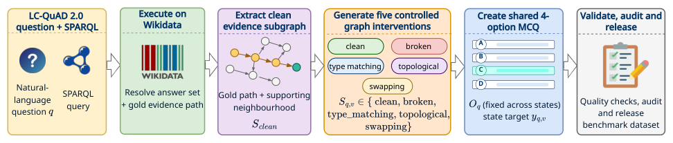

# GRACE: Controlled Evidence Interventions for Diagnosing and Improving Knowledge Integration in GraphRAG

- arXiv: https://arxiv.org/abs/2611.27350  (v1, submitted 2026-11-20, updated 2026-11-20)
- Authors: Minh Pham, Quang Nguyen, Phong Kieu, Cong Tran
- Categories: cs.AI
- Collected: 2026-11-24 (KST)

## Abstract

GraphRAG combines a language model's parametric knowledge with retrieved graph evidence, yet aggregate accuracy cannot show whether failures stem from missing paths, distractors, or conflicts with model knowledge. We introduce GRACE, a benchmark built by executing LC-QuAD 2.0 queries over Wikidata and applying four controlled interventions to each evidence subgraph: severing a support path, adding type-compatible distractors, attaching high-degree hubs, and replacing the supported answer with a counterfactual entity. Questions and option positions remain fixed across the five states. The validated benchmark contains 4,028 questions and 20,140 question-graph pairs. These comparisons reveal that question-only routing cannot distinguish evidence states, while relevance guidance can improve answerable states yet hurt when the support path is severed: relevant facts may not jointly suffice to answer. We propose QCFSE-SA, which combines typed local attention, global graph attention, and question-conditioned evidence guidance with a calibrated graph-support gate. With the factual context and generator held fixed, it improves controlled-state accuracy from 57.17% to 62.78% (+5.61 points; question-clustered 95% CI [+5.04, +6.17]) and broken-state accuracy from 55.41% to 67.85%. Over-abstention on semantic distractors remains an open challenge.

## Figure 1

Fig. 1. GRACE construction pipeline. The question and option interface remain fixed while the evidence graph is transformed into five matched states and validated as one group.
