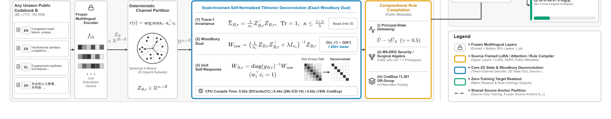

# Ontology-Compiled 2D Clinical State Fields with Bidirectional Diffusion Encoders for Zero-Training Cross-Ontology Medical Coding

- arXiv: https://arxiv.org/abs/2611.30218  (v1, submitted 2026-11-23, updated 2026-11-23)
- Authors: Zeqiang Wang
- Categories: cs.CL, cs.IR, cs.LG
- Collected: 2026-11-24 (KST)

## Abstract

Healthcare systems continually revise clinical taxonomies, update reimbursement schedules, and harmonize cross-border registries. Existing automated coding models bind clinical text understanding to fixed vocabulary-specific heads, requiring manual relabeling and retraining whenever code sets change. We introduce Ontology-Compiled 2D Clinical State Fields (OCSF), a vocabulary-free framework that decouples clinical document reading from target ontology indexing so one trained encoder can switch across arbitrary medical vocabularies in seconds without target training. A single-pass bidirectional diffusion-pretrained encoder and vocabulary-free decoder map each clinical note into a fixed-dimension two-dimensional state matrix with zero code-specific parameters. Any target ontology is compiled offline on CPU from public text descriptions into a scale-invariant Tikhonov deconvolution operator that suppresses sibling-code interference while preserving source decision thresholds. Trained solely on English MIMIC-IV ICD-9 discharge summaries and evaluated without target tuning across 58,706 held-out test notes and five unseen ontologies spanning English ICD-10, MS-DRG, Spanish, Greek, and Chinese (115-185,458 codes), OCSF reaches 63.15% Micro-F1 on in-domain ICD-9 (outperforming a matched closed-vocabulary classifier and eliminating late-epoch tail overfitting) and transfers directly to 26,085 English ICD-10 codes (29.23% recall at gold cardinality), MS-DRG groups, and multilingual terminologies, compiling up to 185,458 codes in under 10 seconds on CPU with sub-millisecond GPU readout.

## Figure 1

Figure 1: Architecture of Ontology-Compiled 2D Clinical State Fields (OCSF). I: A half-frozen bidirectional diffusion encoder maps an unchunked clinical narrative (L ≤3,072) into unit-norm contextual token states H ∈RL×K. II: A vocabulary-free token-channel decoder combines rotation-free cosine routing, multi-head token-to-channel attention, and cross-channel reasoning to emit an ontology-invariant 2D clinical state matrix ˆU(x) ∈RR×K. III: Offline on CPU, any unseen public codebook B is compiled in 0.02–9.68 s via Scale-Invariant Self-Normalized Tikhonov Deconvolution (exact Woodbury dual) and optional compositional rule compilation. IV: Online inference reduces to a single sub-millisecond GPU matrix readout across six clinical ontologies.
