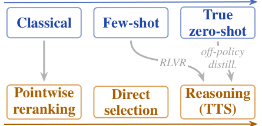

# When Does Reasoning Help Entity Disambiguation? Small LLMs In-Domain and Under Shift

- arXiv: https://arxiv.org/abs/2611.30334  (v1, submitted 2026-11-23, updated 2026-11-23)
- Authors: Samy Haffoudhi, Fabian M Suchanek, Nils Holzenberger
- Categories: cs.CL
- Collected: 2026-11-24 (KST)

## Abstract

Entity disambiguation (mapping ambiguous mentions in text to entities in a knowledge base) is a foundational step in tasks such as knowledge graph construction, question answering, and information extraction. Recent work has applied LLMs to this problem, achieving stateof-the-art performance. Notably, reasoning LLMs have been shown to perform entity disambiguation in a true zero-shot fashion, generalizing across knowledge bases and domains. However, it is unclear whether this capability survives, or remains competitive, with smaller LLMs, where entity disambiguation has typically relied on reranking rather than reasoning. We ask when reasoning is worth its cost at small scale. We compare pointwise, listwise, and reasoning-based candidate-selection components within a classical coarse-to-fine entity disambiguation pipeline, across the classical, few-shot and true zero-shot settings. The reasoning paradigm is trained with distillation and reinforcement learning recipes. The benefit of reasoning grows with domain shift: negligible in-domain, decisive in the true zero-shot setting. We show that two distinct factors are at work: the reranker's uncertainty over the candidates locates where the paradigms disagree, while shift governs which is right when they do.

## Figure 1

Figure 1: Given an ambiguous mention ([Mercury]) in context, entity disambiguation maps it to the correct KB entity (the planet). We study which candidate-selection paradigm (bottom, ordered by inference cost) best suits each ED setting (top, ordered by domain shift), for small LLMs (0.6–4B). Arrows give the mapping we find; la- bels give the training recipe for the reasoning paradigm.
