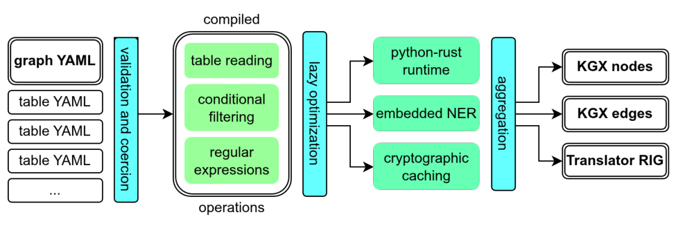

# Tablassert: Declarative Extraction of Knowledge Graphs from Biomedical Tables

- arXiv: https://arxiv.org/abs/2611.31614  (v1, submitted 2026-11-23, updated 2026-11-23)
- Authors: Skye L. Goetz, Jared C. Roach, Gwênlyn Glusman
- Categories: cs.CL
- Collected: 2026-11-25 (KST)

## Abstract

Tables published in biomedical research papers, particularly supplemental tables, capture knowledge assertions that may not be in the main text of the manuscript for several reasons, including low statistical significance, space limitations, and narrative scope. These tables include data (e.g., association statistics, assay readouts, curated gene lists, and omics) encoding relationships between biological entities. Tablassert converts such tabular data (Excel, CSV, TSV, Parquet) into knowledge graphs ready for the NCATS Biomedical Data Translator (Fecho et al. 2025). A user declares in YAML how each table's data map to subject-predicate-object-qualifier statements; Tablassert resolves free text (e.g., ''lung cancer'') to standard identifiers, attaches provenance and statistics, and emits graph files conforming to Translator standards (D. Unni, Bruskiewich, and Moxon 2026; D. R. Unni et al. 2022).

## Figure 1

Figure 1: Tablassert Architecture. Graph and table YAMLs encode declar- ative transformations that are validated and coerced, compiled into operations, lazily optimized, and executed using a Python-Rust runtime, embedded named- entity recognition, and cryptographic caching. Outputs from individual tables are aggregated into one Biolink-conformant knowledge graph, exported as KGX nodes and edges alongside Translator Resource Ingest Guide (RIG) metadata.
