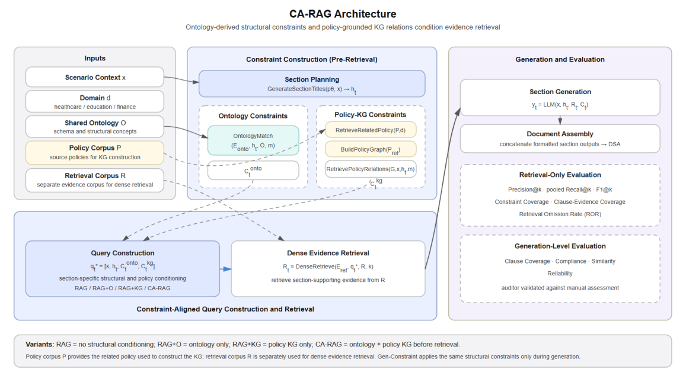

# CA-RAG: Constraint-Aligned Retrieval for Structurally Faithful Long-Form Generation

- arXiv: https://arxiv.org/abs/2611.33497  (v1, submitted 2026-11-24, updated 2026-11-24)
- Authors: Vimal Kumar Kumar, Meghana Kshirsagar, Conor Ryan
- Categories: cs.AI, cs.CL, cs.IR
- Collected: 2026-11-26 (KST)

## Abstract

Retrieval-augmented generation (RAG) typically optimises evidence selection for semantic relevance, whereas compliance-sensitive long-form generation also requires evidence supporting explicit structural obligations. Semantically relevant retrieval may therefore omit information needed for mandatory downstream clauses. We propose Constraint-Aligned RAG (CA-RAG), a retrieval-conditioning framework that augments section-specific queries with ontology-derived structural constraints and policy-grounded knowledge-graph relations before evidence selection. Retrieval-only evaluation with manually annotated evidence shows consistent improvements across retrieval budgets. At $k=6$, CA-RAG increases Precision@$k$ from $0.5268$ to $0.5692$, pooled Recall@$k$ from $0.5402$ to $0.5950$, and F1@$k$ from $0.5389$ to $0.5672$ over standard RAG. Generation experiments further show improvements in compliance and reliability in several model--domain settings, while generation-only constraints achieve higher clause coverage but lower overall compliance and reliability. These results indicate that structurally aligned retrieval can improve evidence sufficiency in compliance-sensitive long-form generation.

## Figure 1

Figure 1: Overview of CA-RAG: retrieval conditioned on structural and policy constraints for long-form generation.
