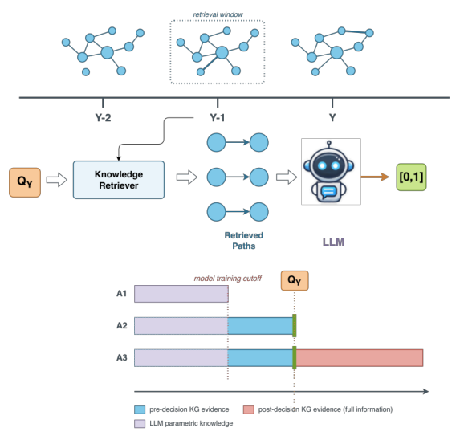

# Did the Model Forecast It, or Already Know It? Evaluating Large Language Models for Novel Drug-Target Prioritisation with a Temporal Knowledge-Graph Oracle

- arXiv: https://arxiv.org/abs/2611.34247  (v1, submitted 2026-11-25, updated 2026-11-25)
- Authors: Pui Chung Siu, Yuan Liang, Claudia Cabrera, Mani Mudaliar, Arkaitz Zubiaga
- Categories: cs.AI, q-bio.QM
- Collected: 2026-11-26 (KST)

## Abstract

AI systems increasingly help decide which drug targets enter costly clinical trials. We recast each target-disease hypothesis as a dated event, the pair's first clinical trial. This lets us test whether a language model can forecast such events after its training cutoff, rather than recall events before it. We rebuild a dated biomedical knowledge graph as it stood at the end of each year from 2020 up to its newest version. We then ask six open language models, with and without this graph, which targets will enter a first trial for a disease the next year. Without retrieval, the models rank about as well as trial history, a count of each target's past trials in the same therapeutic area, also after their training cutoffs. Evidence dated before the decision adds at most a small gain, before or after the models' training cutoffs. The newest graph raises five of six models clearly above that baseline, but its paths usually include the answer: the pair's own trial, dated after the decision. Evaluations of target prioritisation should date both features and labels, with evidence from before the decision and outcomes after it.

## Figure 1

Figure 1: Overview. For a target–disease pair queried for year Y , we retrieve evidence paths from the dated knowledge graph and prompt a language model to score the pair. Top: annual graph snapshots. The snapshot at C = Y −1 is retrieved, excluding the predicted event. Bottom: the access conditions relative to the model’s training cutoff: no retrieval with descriptions (A1), dated graph (A2) and the newest snapshot (A3).
