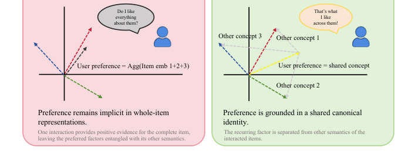

# Grounding User Preferences in Shared Multimodal Concepts for Recommendation

- arXiv: https://arxiv.org/abs/2611.34436  (v1, submitted 2026-11-25, updated 2026-11-25)
- Authors: Ao Xu, Jinhui Huang, Wenqiang Tang, Tiehua Mei, Hongru Hou, Hengrui Chen, Jiaqing Liang, Deqing Yang
- Categories: cs.IR
- Collected: 2026-11-27 (KST)

## Abstract

Multimodal recommendation has substantially advanced item understanding by incorporating rich visual and textual content. Yet user preferences are still commonly encoded as implicit signals tied to individual items, leaving recurring semantic factors without persistent identities that can be shared across items. We introduce MKGE, a multimodal knowledge graph framework that represents these factors as canonical, addressable concepts. MKGE induces a domain-adaptive concept vocabulary from item images and titles, grounds each user's interaction history in supported concepts, and jointly models direct user-item evidence and concept-mediated preference signals. By turning recurring semantics into shared coordinates, MKGE enables evidence from different items to accumulate around the same preference factors. Extensive experiments on three public benchmarks demonstrate that MKGE consistently outperforms collaborative, knowledge-graph, multimodal, and recent LLM/MLLM-based recommenders across all six reported metrics. Controlled studies further demonstrate the importance of canonical concept identities and personalized user-concept correspondence, with especially pronounced gains over removing or rewiring the user graph for low-activity users. These results establish canonical multimodal concepts as effective units for preference modeling and transfer. Code, constructed knowledge graphs, and prompts are available at https://github.com/Garden1a-X/MKGE.

## Figure 1

Figure 1: Why user preference should be grounded beyond whole items. A user’s history contains items with diverse multimodal semantics. (a) Whole-item aggregation leaves a recurring preferred factor implicit and entangled with other item semantics. (b) MKGE gives that factor a shared canon- ical identity, making it an explicit coordinate for user pref- erence.
